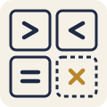

<p align="center"></p>

<h1 align="center">The Baney Extended System</h1>
<p align="center"><b>Do. Keep. Know. Let go.</b><br>Sort everything by what it asks of you.</p>

---

Most filing systems ask what a thing is about. This one asks what a thing asks of you, and that gives four rooms:

| | Room | What goes here | Paper mark |
| --- | --- | --- | --- |
| 0 | **Inbox** | Only what the machine could not decide. | |
| 1 | **Do** | Anything that asks something of you: a reply, a bill, a form, a project you are making. | `>` |
| 2 | **Keep** | Your story and your records: photos, letters, voicemails, texts, receipts, IDs. | `<` |
| 3 | **Know** | The world's knowledge you gathered: books, papers, class notes, videos, citations. | `=` |
| 4 | **Let Go** | Everything else. Held for a season, emptied only when you say. | `x` |

The same four rooms work for files, mail, notes, paper, texts, calls, voicemails and media. **The system sorts; you only correct.**

## Start in one minute

```
git clone https://github.com/baney75/baney-extended-system
cd baney-extended-system
python3 -m bes init ~/BES          # makes the five folders and BES.md
python3 -m bes sort ~/BES --dry-run
python3 -m bes autostart           # sorts every 15 minutes from now on
```

Python 3.11 or newer, standard library only. `yt-dlp` and `tesseract` are used when present.

| Command | What it does |
| --- | --- |
| `bes init ROOT` | Make the rooms on a drive. |
| `bes sort [ROOT ...] [--dry-run]` | File the Inbox and drop folders, rename to `YYYY-MM-DD Title (People).ext`. |
| `bes undo [ROOT] [--last N]` | Reverse moves from the journal. |
| `bes letgo [ROOT] [--empty]` | List Let Go; empty it only after you confirm. |
| `bes cite URL` | Write a citation card (APA, MLA, Chicago) to `3 Know/Citations`. |
| `bes index [ROOT]` | Rebuild the index AI agents read. |
| `bes autostart [--remove]` | Install or remove the 15-minute timer. |

`bes` never deletes a file on its own. Every move is journaled and can be undone.

## Everywhere else

- **Mail:** [Gmail filters and a Proton Sieve script](docs/mail.md). The inbox keeps people and asks; the crowd is labeled and archived.
- **Paper:** [one tray, four corner marks, scan to the Inbox](docs/paper.md).
- **Phone:** [texts, calls and voicemails](docs/phone.md).
- **Media and citations:** [YouTube and the web](docs/media.md).
- **Drives and clouds:** [NAS, Google Drive, OneDrive, Proton Drive](docs/drives.md).
- **Notion:** [a Room property and four views](docs/notion.md).
- **AI agents:** [BES.md and the index](docs/ai.md).
- **Operating systems:** [a thought experiment](docs/os.md).

## Why it works

Augustine named three powers of the mind: memory, understanding and will. Keep, Know and Do follow them. Kierkegaard asked to "get clear about what I must do, not what I must know," and warned that "the crowd is untruth." Ecclesiastes gives "a time to keep, and a time to cast away." Memory science adds that attention holds about four things and that your own story and the world's facts are different kinds of memory.

Read the [theory](THEORY.md), the [specification](SPEC.md), and the [research behind it](docs/research.html), a survey of about 90 theories of the mind.

## License

MIT
